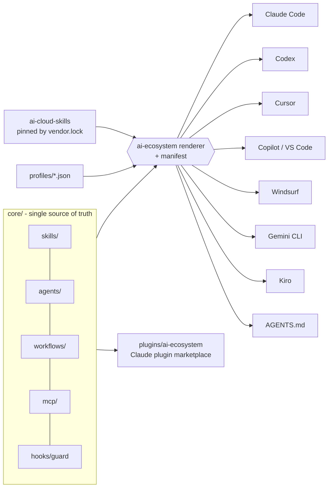

# ai-ecosystem

One source of truth for **skills, SDLC agents, workflows, MCP servers and safety hooks**, installed in the native format of your AI coding tool: **Claude Code, OpenAI Codex, Cursor, GitHub Copilot / VS Code, Windsurf (Devin), Gemini CLI and Kiro**, plus a universal `AGENTS.md`.

Pick a profile (web app, API, mobile, data/ML, testing, IaC for AWS/Azure/GCP, Kubernetes) and you get the right skills plus a dedicated agent for each SDLC stage: plan, design, build, review, test, secure, deploy, document and release. Cloud and language skills come from [ai-cloud-skills](https://github.com/nkandagatla/ai-cloud-skills), pinned to a specific commit.

## Install

```bash
# pipx (recommended)
pipx install git+https://github.com/nkandagatla/ai-ecosystem && ai-ecosystem sync && ai-ecosystem

# npx (needs python3 on PATH)
npx github:nkandagatla/ai-ecosystem

# curl one-liner (downloads to ~/.ai-ecosystem/src)
curl -fsSL https://raw.githubusercontent.com/nkandagatla/ai-ecosystem/main/get.sh | bash -s -- --sync

# from a clone
git clone https://github.com/nkandagatla/ai-ecosystem && cd ai-ecosystem && ./install.sh --sync
```

The wizard asks for:
1. **Scope:** `project` (the current repo, or `--dir`) or `user` (global, under `~`).
2. **Target tools:** you can type numbers (`1,3`), names (`claude,cursor`) or `all`.
3. **Profile.**
4. Optional agent and skill selection.

It then shows the plan and asks you to confirm. Every prompt has a flag equivalent:

```bash
ai-ecosystem install --yes --target claude,codex,cursor --scope project --profile web-app --dir /path/to/repo
ai-ecosystem install --yes --target all --scope user --profile aws-iac
ai-ecosystem install --yes --target copilot --profile testing --agents planner,tester,developer --skills test-strategy,code-fundamentals
ai-ecosystem install --dry-run ...          # show what would change
ai-ecosystem update  [--scope user]         # re-render from the manifest; keeps files you edited (unless --force)
ai-ecosystem uninstall [--scope user]       # removes only what it added
ai-ecosystem list | validate | sync [--latest] | build-plugin [--check]
```

Flags:
- `--mcp github,playwright` or `--mcp none` overrides the profile's MCP servers. `--no-mcp` and `--no-hooks` turn those features off.
- `--force` overwrites files you have edited.
- Target aliases: `.claude`, `.github`/`github`/`vscode` → copilot, `devin` → windsurf, `gemini-cli` → gemini.
- The v1 flags (`--uninstall`, `--update`, `--list`, `--sync`) still work.

Claude Code users can also install everything as a plugin:

```
/plugin marketplace add nkandagatla/ai-ecosystem
/plugin install ai-ecosystem@ai-ecosystem
```

## Architecture



## SDLC agents

| Stage | Agent | Role | Read-only | Hands off to |
|---|---|---|---|---|
| Plan | `planner` | Requirements, stories, acceptance criteria | | architect |
| Design | `architect` | Stack, structure, ADRs | | developer |
| Build | `developer` | Small, tested increments | | reviewer, tester |
| Review | `reviewer` | Diff review with severities | yes | developer, tester |
| Test | `tester` | Unit, integration and e2e tests; defects | | developer, security |
| Secure | `security` | Threat model, scans, IaC security | yes | developer, devops |
| Deploy | `devops` | CI/CD; IaC with plan before apply | | release |
| Document | `docs` | README, runbooks, changelog | | release |
| Release | `release` | Semver, release notes, rollout and rollback | | |

The neutral fields `readonly`, `model` and `handoffs` are mapped to each tool's native fields:
- **Claude:** `tools`, `skills` preload
- **Cursor:** `readonly`, `model: inherit`
- **Copilot:** `tools: ['read','search']`, `handoffs` buttons
- **Codex:** TOML `developer_instructions`

## Workflows
`vibe-code-web-page`, `iac-change`, `test-campaign` and `bugfix` run the agents in order, passing artifacts through `docs/`. They are installed as skills, so the same file works in Claude (`/bugfix`), Codex, Cursor and Copilot. They are also installed as Copilot prompt files, Windsurf workflows, Gemini commands (`/bugfix`) and Kiro manual steering. Any step that publishes, deploys or applies IaC stops for human approval. See [examples/vibe-web-page](examples/vibe-web-page).

## Profiles
| Profile | Extends | Highlights |
|---|---|---|
| `general` | | Full SDLC team, core skills, `bugfix`, context7 MCP |
| `web-app` | general | Frontend, HTML/CSS/JS, `vibe-code-web-page`, Playwright MCP |
| `api-backend` | general | `api-design`, Node/Python/Java/Go, DB migrations and SQL safety, GitHub MCP |
| `mobile` | general | `mobile-app-basics`, `api-design` |
| `data-ml` | general | Python, SQL, BigQuery, LLM cost and caching |
| `testing` | | QA-focused team, `test-campaign`, Playwright MCP |
| `infrastructure-as-code` (`iac`) | | Cloud guardrails, Terraform, OIDC, policy as code, `iac-change`, Terraform MCP |
| `aws-iac` / `azure-iac` / `gcp-iac` | iac | Provider foundations, networking, IAM, secrets, cost (AWS docs MCP) |
| `k8s-platform` (`k8s`) | iac | Kubernetes ops, supply chain, EKS/AKS/GKE |

Custom profiles go in `profiles/<name>.json` with the keys `agents`, `skills`, `workflows`, `external_skills`, `mcp` and an optional `extends`.

## Layout reference (verified against the official docs, Oct 2026)

| Tool | Project scope | User scope |
|---|---|---|
| **Claude Code** | `.claude/agents/*.md`, `.claude/skills/<n>/SKILL.md`, `CLAUDE.md` → `@AGENTS.md`, `.claude/settings.json` PreToolUse hook, `.mcp.json` | `~/.claude/{agents,skills,CLAUDE.md,settings.json}` (MCP: printed `claude mcp add --scope user` hint) |
| **Codex** | `.agents/skills/`, `.codex/agents/*.toml`, `.codex/config.toml` `[mcp_servers.*]`, `AGENTS.md` | `~/.agents/skills`, `~/.codex/agents`, `~/.codex/AGENTS.md`, `~/.codex/config.toml` |
| **Cursor** | `.cursor/agents/*.md`, `.agents/skills/`, `.cursor/hooks.json` beforeShellExecution, `.cursor/mcp.json`, `AGENTS.md` | `~/.cursor/{agents,hooks.json,mcp.json}`, `~/.agents/skills` |
| **Copilot / VS Code** | `.github/agents/*.agent.md`, `.agents/skills/`, `.github/prompts/*.prompt.md` (`agent:`), `.vscode/mcp.json` (`servers`), `AGENTS.md` | `~/.copilot/agents`, `~/.agents/skills` |
| **Windsurf** | `.windsurf/rules/*.md` (`trigger`; 12,000-char limit enforced), `.windsurf/workflows/`, `AGENTS.md` | `~/.codeium/windsurf/memories/global_rules.md` (≤6,000 chars) |
| **Gemini CLI** | `GEMINI.md` → `@./AGENTS.md`, `.gemini/commands/{<wf>,agent/<n>,skill/<n>}.toml`, `.gemini/settings.json` `mcpServers` | `~/.gemini/{GEMINI.md,commands,settings.json}` |
| **Kiro** | `.kiro/steering/*.md` (`inclusion: auto/manual`), `.kiro/settings/mcp.json`, `AGENTS.md` | `~/.kiro/steering` (+ `AGENTS.md`), `~/.kiro/settings/mcp.json` |

Sources:
- [Codex skills](https://developers.openai.com/codex/skills) and [subagents](https://developers.openai.com/codex/subagents)
- Claude [sub-agents](https://code.claude.com/docs/en/sub-agents), [hooks](https://code.claude.com/docs/en/hooks) and [plugin marketplaces](https://code.claude.com/docs/en/plugin-marketplaces)
- Cursor [subagents](https://cursor.com/docs/context/subagents), [hooks](https://cursor.com/docs/agent/hooks) and [MCP](https://cursor.com/docs/context/mcp)
- VS Code [custom agents](https://code.visualstudio.com/docs/copilot/customization/custom-agents), [skills](https://code.visualstudio.com/docs/copilot/customization/agent-skills), [prompt files](https://code.visualstudio.com/docs/copilot/customization/prompt-files) and [MCP](https://code.visualstudio.com/docs/copilot/customization/mcp-servers)
- [Windsurf memories and rules](https://docs.windsurf.com/windsurf/cascade/memories)
- Gemini CLI [commands](https://geminicli.com/docs/cli/custom-commands/), [GEMINI.md](https://geminicli.com/docs/cli/gemini-md/) and [MCP](https://geminicli.com/docs/tools/mcp-server/)
- Kiro [steering](https://kiro.dev/docs/steering/) and [MCP](https://kiro.dev/docs/mcp/configuration/)

**Not generated (formats not confirmed in the official docs):**
- Cursor plugin marketplace
- Hooks for Codex, Copilot, Gemini and Kiro
- Windsurf MCP, skills and global workflows
- Native agent and skill formats for Gemini and Kiro (they get commands and steering instead)
- User-scope MCP for Claude (`~/.claude.json` is not edited) and Copilot (it lives in the VS Code profile)

## Safety guard hook
`core/hooks/ai-ecosystem-guard.py` (stdlib Python) is wired into Claude Code `PreToolUse` (Bash) and Cursor `beforeShellExecution`.
- **Blocked outright:** `rm -rf /` or `~`, force-push to main, piping `curl` into a shell, `--no-verify`, disk formatting.
- **Asks for human approval:** `terraform`/`tofu apply|destroy`, cdk/pulumi deploys, cloud deletes and IAM changes, `kubectl delete`, force-push, `git reset --hard`, package publishing, `DROP`/`TRUNCATE`.

You can set `AI_ECOSYSTEM_GUARD=off`, or add rules with `AI_ECOSYSTEM_GUARD_DENY` / `AI_ECOSYSTEM_GUARD_ASK` (regexes separated by `;;`).

## MCP servers
Neutral definitions live in `core/mcp/*.json` (`github`, `playwright`, `context7`, `aws-docs`, `terraform`). They are written in each tool's format: `mcpServers`, VS Code `servers`, Codex TOML, and Gemini `httpUrl`. `${VAR}` references are written as `${env:VAR}` where the tool requires that (Cursor, VS Code).

## Safe merging, update and uninstall
- The installer never clobbers your config:
  - `AGENTS.md`, `CLAUDE.md`, `GEMINI.md` and `.codex/config.toml` get a managed block.
  - JSON settings (`settings.json`, `hooks.json`, `mcp.json`) are merged key by key, and any server you already defined is kept.
  - Files with invalid JSON are left untouched, with a warning.
- A manifest records the sha256 of every generated file, each merged key and hook entry, and every directory it created:
  - Project scope: `<dir>/.ai-ecosystem.json`.
  - User scope: `~/.ai-ecosystem/manifest.json`.
- `update` keeps files you edited and removes generated files that are no longer needed. `uninstall` removes only what was added and prunes only directories it created.

## ai-cloud-skills
`ai-ecosystem sync` checks out the commit pinned in `vendor.lock` into `vendor/ai-cloud-skills`, or `~/.ai-ecosystem/vendor` for pipx/npx installs. Run `sync --latest` to move the pin. You can also set `AI_CLOUD_SKILLS_DIR` to point at your own checkout.

## Develop
```bash
./scripts/sync-cloud-skills.sh
./tests/test_install.sh           # runs `validate` + the unittest suite (every profile x target x scope)
python3 scripts/ai_ecosystem.py build-plugin   # regenerate plugins/ after editing core/
```

See [CONTRIBUTING.md](CONTRIBUTING.md) and [CHANGELOG.md](CHANGELOG.md). MIT licensed.
