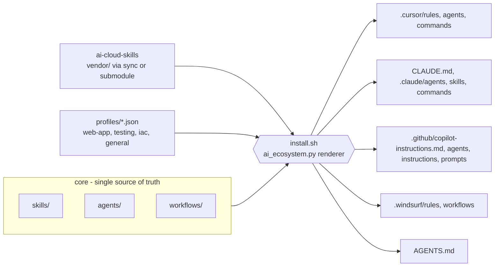

# ai-ecosystem

One source of truth for **skills, SDLC agents and workflows**, installed into whatever AI coding tool you use: **Cursor, Claude Code, VS Code / GitHub Copilot, Windsurf** (plus a universal `AGENTS.md`).

Pick a profile (web app, testing, infrastructure-as-code, general) and the installer loads the right skills and a dedicated agent for every SDLC stage: plan, design, build, review, test, secure, deploy, document, release.

## Quickstart

```bash
git clone https://github.com/nkandagatla/ai-ecosystem && cd ai-ecosystem
./install.sh --sync          # interactive: pick tools, scope, profile, agents/skills
```

The wizard asks for: (1) **targets** (multi-select): `.claude`, `.codex` (AGENTS.md), `.cursor`, `.github` (Copilot), `.windsurf`; (2) **scope**: `project` (current repo, `--dir`) or `user` (global: `~/.claude`, `~/.codex`, `~/.cursor`, `~/.codeium/windsurf`); (3) **profile** (`general`, `web-app`, `testing`, `infrastructure-as-code`) and optional agent/skill selection; then shows a plan and confirms.

Non-interactive / CI equivalents:

```bash
./install.sh --sync --yes --target claude,codex,cursor --scope project --profile web-app --dir /path/to/repo
./install.sh --yes --target claude,codex,cursor --scope user --profile iac
./install.sh --yes --target all --profile testing --agents planner,tester,developer --skills test-strategy,code-fundamentals
./install.sh --dry-run ...    # preview files
./install.sh --update --yes   # re-render from the manifest (picks up new versions of core/)
./install.sh --uninstall --scope project --dir /path/to/repo
```

- `--sync` pulls [ai-cloud-skills](https://github.com/nkandagatla/ai-cloud-skills) into `vendor/` so profiles can include its skills.
- Targets: `claude,codex,cursor,copilot` (alias `github`), `windsurf`, or `all`. `--home` overrides `$HOME` for user scope.
- Uninstall removes exactly what was installed (tracked in `.ai-ecosystem.json`); your own content in `AGENTS.md`/`CLAUDE.md` is preserved via managed blocks.
- User scope notes: Copilot has no stable file-based global scope (skipped); Cursor gets agents/skills/commands (global rules are UI-only); Windsurf gets global rules + workflows.
- Requires only `bash`, `python3`, `git`.

Then, e.g. in Claude Code run `/vibe-code-web-page landing page for a coffee shop`.

## Architecture



## SDLC agents

| Stage | Agent | Role |
|---|---|---|
| Plan | `planner` | Requirements, stories, acceptance criteria |
| Design | `architect` | Stack, structure, ADRs |
| Build | `developer` | Small tested increments |
| Review | `reviewer` | Diff review with severities |
| Test | `tester` | Unit/integration/e2e, defects |
| Secure | `security` | Threat model, scans, IaC security |
| Deploy | `devops` | CI/CD, IaC with plan-before-apply |
| Document | `docs` | README, runbooks, changelog |
| Release | `release` | Semver, notes, rollout/rollback |

## Workflows
`vibe-code-web-page`, `iac-change`, `test-campaign`, `bugfix` chain the agents in order, passing artifacts through `docs/plan.md` and `docs/adr/`. Anything that publishes, deploys or applies IaC stops for human approval.

## Where things land

| Tool | Agents | Skills | Workflows | Index |
|---|---|---|---|---|
| Codex | `.codex/agents` (user) | `.codex/skills` | `.codex/prompts` | `AGENTS.md` |
| Cursor | `.cursor/agents` | `.cursor/rules/*.mdc` | `.cursor/commands` | always-on rule |
| Claude Code | `.claude/agents` | `.claude/skills` | `.claude/commands` | `CLAUDE.md` (imports `AGENTS.md`) |
| Copilot | `.github/agents/*.agent.md` | `.github/instructions` | `.github/prompts` | `copilot-instructions.md` |
| Windsurf | `.windsurf/rules/agent-*.md` | `.windsurf/rules` | `.windsurf/workflows` | always-on rule |

Tools without native subagents (Windsurf, Copilot) get each agent as a role the model adopts on demand.

## Linking ai-cloud-skills
Default: `./scripts/sync-cloud-skills.sh` (shallow clone into gitignored `vendor/`). Or use a submodule: `git submodule add https://github.com/nkandagatla/ai-cloud-skills vendor/ai-cloud-skills`. Profiles list names under `external_skills`; missing ones are skipped with a note.

## Custom profiles
Add `profiles/<name>.json`: `agents`, `skills`, `workflows`, `external_skills`, optional `extends`.

## Test
`./tests/test_install.sh` installs every profile x target x scope into temp dirs, checks layout, idempotency, update, dry-run, the interactive flow, and clean uninstall.

See [CONTRIBUTING.md](CONTRIBUTING.md). MIT licensed.
